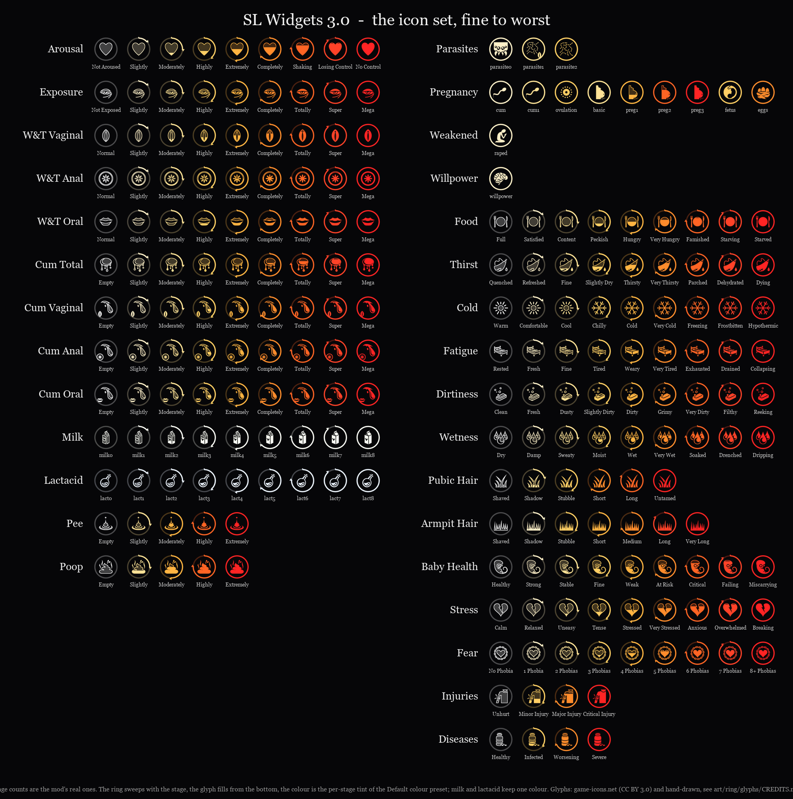
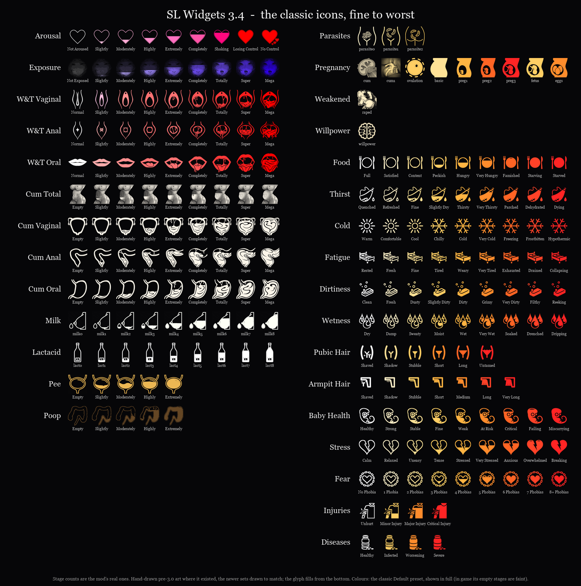

# Customization

---

## Icon placement and sizing

SL Widgets displays icons through iWant Status Bars. All placement, sizing, and recolouring of individual icons is done in the **iWant Status Bars MCM**, not in the SL Widgets MCM. Refer to iWant's documentation for how to:

- Move bars to different screen positions
- Change icon size
- Adjust bar orientation (horizontal / vertical)
- Show or hide specific bars

SL Widgets picks up layout changes on the next update tick — no reload required.

!!! tip "See the result as you go"
    With SKSE Menu Framework installed, the [SKSE menu's Positions page](position-editor.md#positions) moves the bars, the NPC cluster and the meter stack on the HUD as you change its sliders, with the game in view. For the bars it writes the same values iWant Status Bars' own MCM sliders hold.

---

## Screen coordinates

iWant Status Bars (and SL Widgets through it) uses Skyrim's **fixed 1280 × 720 Flash stage**. Skyrim scales this stage to fit any monitor. The same X/Y coordinate produces the same visual position on every resolution — 1080p, 1440p, 4K, and ultrawide all use the same values.

| Area | X range | Y range |
|------|---------|---------|
| Standard 16:9 stage | 0–1279 | 0–719 |
| 21:9 ultrawide (extended stage) | up to ~1680 | 0–719 |
| 32:9 super-ultrawide (extended stage) | up to ~2560 | 0–719 |

!!! warning
    Going past X = 1279 on a standard stage clips icons. Extended-stage coordinates only work with a HUD mod that widens the Flash stage (SkyHUD, True Directional Movement, etc.).

!!! tip "Ultrawide with the Prisma renderer"
    The [Prisma renderer](prisma.md) centres the stage instead of stretching it, putting the ultrawide **left** margin at *negative* X (about −200 on 21:9, −640 on 32:9) with no extended-stage HUD mod needed. Both MCMs accept negative slider values — see [Ultrawide positioning](prisma.md#ultrawide-positioning).

The NPC cluster sliders on the NPC Tracking page default to `npcGroupX = 1100, npcGroupY = 600` to match iWant's own bottom-right anchor convention within the standard stage.

---

## Color presets

Color presets replace the default icon RGB values with custom ones without changing the icon graphics.

**Preset files:** `Data/SKSE/Plugins/SlWidgets/IconPresets/*.json`

Pick a preset with **Color Preset** on the SKSE menu's [General](position-editor.md#general) page.

### Shipped presets

| Preset | Colours | Empty stage | Other stages |
|--------|---------|-------------|--------------|
| `Default` | white to ice blue to violet to magenta to red as a value worsens | fully visible | fully visible |
| `HideEmpty` | as `Default` | hidden | the first step faint, then fully visible |
| `AllWhite` | all white | faint | the first step faint, then fully visible |
| `AllWhite_HideEmpty` | all white | hidden | the first step faint, then fully visible |

A hidden empty stage is an icon at alpha 0. With iWant's **Skip Hidden Icons** on for the bar (iWant's default), the bar closes up around it; with it off, the icon keeps an empty slot. The optional Classic Icons download brings its own `Default` and `HideEmpty`, the colours SL Widgets used before 3.0.0.

### File format

```json
{
  ".IconName": {
    "r": [200, 150, 100, ...],
    "g": [50, 80, 120, ...],
    "b": [255, 240, 200, ...],
    "a": [255, 255, 255, ...]
  }
}
```

Each key is an icon base name prefixed with `.`. The arrays contain one value per state (0–8 for 9-stage icons). The `Default` preset is always available as a fallback.

---

## Settings presets

Settings presets save and restore SL Widgets' settings in one step, useful for switching between characters or playstyles, or for starting a new game with everything in place.

**Preset files:** `Data/SKSE/Plugins/SlWidgets/SettingsPresets/*.json`

A saved preset includes:

- Update interval
- Active color preset
- Every player icon switch
- All per-NPC sub-toggles for slots 1–3
- The meter switches, how the meters show, and the stack's position and size
- The layout (since 3.2): position, icon size and shape of iWant's player bars 0-3, and the NPC cluster's position and spacing
- The icon spacing of iWant's line bars (since 3.4.1)

A preset saved before 3.2 holds no bar or NPC cluster layout, and loading it leaves those where they are; one saved before 3.4.1 leaves the icon spacing alone. Bars 0-3 are iWant's shared bars, so a preset's layout moves every mod's icons in them.

**To save or load:** the SKSE menu's [Presets](position-editor.md#presets) page: load one, save over one, or save under a new name.

---

## Icon styles

Since 3.0.0 the mod ships one icon set: every icon drawn in the same style, a progress ring around a glyph that fills from the bottom, tinted from white through ice blue and violet to magenta and red as the value worsens (since 3.4.0; 3.0 used white through gold and orange to red). Milk and lactacid keep one colour. The `Default` colour preset is that ramp, fully visible at every stage; `HideEmpty` is the same ramp with the empty stage hidden (see [Shipped presets](#shipped-presets)).

The icons SL Widgets shipped before 3.0.0 are the **Classic icons** option of the installer. Since 3.4.0 it covers every set: the hand-drawn art for the sets that existed before 3.0.0, and the newer sets drawn in the same manner (a big outline that fills from the bottom, no ring), together with the classic Default and HideEmpty colour presets, whose empty stages are faint. Reinstall the mod to switch styles; custom packs install on top of either.



The classic icons, the same sets:



---

## Custom icon packs

Prefer ready-made alternatives? See the [Custom Icon Packs](custom-packs.md) page for community packs that restyle the arousal, Fill Her Up, and pregnancy icons — install one and let it overwrite the stock textures.

To make your own, you can replace or add icons by dropping `.dds` files into the appropriate iWant library folder.

**Path:** `Data/Interface/exported/widgets/iwant/widgets/library/...`

Follow the naming convention already used by SL Widgets (visible in the installed files).

**Icon format requirements:**

| Property | Value |
|----------|-------|
| Format | DDS |
| Compression | BC3 (DXT5) |
| Size | 100 × 100 px |
| Mipmaps | None |

GIMP can export DDS in BC3 without mipmaps. Photoshop requires the Intel Texture Works plugin or similar.

### DDS headers

The Flash-based iWant Widgets is strict about two DDS header fields that GIMP, Paint.NET and texconv fill in correctly but Pillow (the Python imaging library) does not: `dwPitchOrLinearSize` must be the byte size of the image (10000 for a 100 × 100 BC3 file) and the pixel format's bit count must be 0 for a compressed format. An icon with Pillow's values draws as a diagonal streak. If you generate icons with Pillow, write them through SL Widgets' `savedds.py` (`save_dxt5`, or `python savedds.py --fix <folder>` on files you already have); it is in the mod's source repository.

!!! tip "PNG and animated GIF"
    With the optional [Prisma renderer](prisma.md) (0.4.0+), an icon can instead be a `.png` or an animated `.gif` dropped beside the `.dds` — no DDS export, no conversion. The renderer picks it up automatically. See [Animated and alternate-format icons](prisma.md#animated-and-alternate-format-icons).

!!! tip
    Swapping a `.dds` file replaces the icon for every character and NPC using that icon name. Icon names include the slot suffix for NPC variants (`Arousal_NPC1.dds`, `Arousal_NPC2.dds`, `Arousal_NPC3.dds`).
